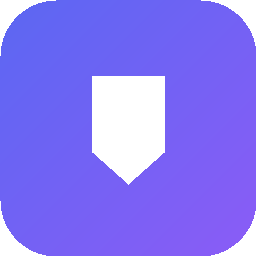

<p align="center">
  
</p>

<h1 align="center">MarkDeck</h1>

<p align="center">
  自托管浏览器书签同步服务 —— 一个 Go 单二进制 + 浏览器插件<br/>让你的书签在 Chrome、Edge 等所有设备间<b>双向实时同步、离线可用</b>
</p>

<p align="center">
  
  
  
  
</p>

## 为什么是 MarkDeck

| 痛点 | MarkDeck 的答案 |
|---|---|
| Chrome 和 Edge 的书签互不同步 | 一套服务端打通所有 Chromium 内核浏览器 |
| 不想为同步书签登录 Google/Microsoft 账号 | 自托管，数据完全在你手里 |
| 浏览器同步没有回收站，误删即丢 | 服务端回收站 + 每日快照，随时恢复 |
| 换浏览器/换电脑迁移书签麻烦 | 新设备装插件配对一次，自动全量同步 |
| 书签越攒越乱 | 全文搜索、标签系统、死链检测、重复清理 |

## 功能

**同步**
- 🔁 双向实时同步：WebSocket 推送，任何一端变更秒级到达其他设备
- 📴 离线可用：断联时改动本地排队，恢复后自动重放合并（书签查看/搜索/新增始终可用）
- ⚖️ 冲突自动裁决：Last-Writer-Wins，确定性收敛
- 🚨 同步冲突检测：自动发现与浏览器自带书签同步打架产生的重复书签，一键跳转关闭

**管理页面**（Vue3，嵌入单二进制）
- 📂 文件夹树 + 拖拽整理 + 批量操作（移动 / 删除 / 打标签）
- 🔍 全文搜索（FTS5 trigram，中文与子串友好）+ 标签筛选
- 🗑️ 回收站（恢复 / 彻底删除）
- 🏷️ 标签管理：重命名、合并、删除
- 🌐 真实站点图标（favicon）自动抓取缓存
- 🛠️ 工具中心：死链检测（区分真死链与反爬拦截）、重复书签一键合并
- 📥 浏览器书签导入（Chrome/Edge/Firefox HTML，URL 去重）、HTML/JSON 导出
- 💾 快照备份：每日自动 + 手动，保留 30 份，可下载可恢复

**安全**
- 🔐 argon2id 密码、登录限速锁定、会话 + CSRF
- 🔢 可选 TOTP 两步验证
- 🔑 设备配对：一次性配对码 → 长期令牌（服务端只存哈希），随时吊销

## 快速开始（Docker，推荐）

```bash
mkdir markdeck && cd markdeck
# 下载 docker-compose.yml（见仓库根目录），然后：
docker compose up -d
```

打开 `http://localhost:8990`，首次运行创建管理员密码，完成。

浏览器端：管理页面 → 设置 → 设备同步 → 生成配对码 → 在 Chrome/Edge 安装插件（[Releases](../../releases) 下载 zip 解压加载）→ 填入地址与配对码。

> ⚠️ **与浏览器自带书签同步二选一**：如果浏览器账号同步（Chrome Sync / Edge 同步）开着，请在浏览器设置中关闭「书签」一项（密码、历史不受影响），避免两套同步互相覆盖。插件检测到重复书签时会自动提醒并提供一键跳转。

## 源码构建

依赖：Go 1.23+、Node 22+

```bash
cd web && npm ci && npm run build          # 管理页面 → 嵌入二进制
cd ../server && go build -o markdeck ./cmd/markdeck
MARKDECK_ADDR=127.0.0.1:8990 MARKDECK_DATA=./data ./markdeck
```

插件：`cd extension && npm ci && npm run build` → 加载 `extension/dist`。

## 配置

| 环境变量 | 默认值 | 说明 |
|---|---|---|
| `MARKDECK_ADDR` | `127.0.0.1:8990` | HTTP 监听地址 |
| `MARKDECK_DATA` | `./data` | 数据目录（SQLite + 快照） |
| `MARKDECK_BASE_URL` | 空 | 对外地址；HTTPS 时 Cookie 加 Secure、TOTP 链接用它 |
| `MARKDECK_SESSION_TTL_HOURS` | `336` | 登录会话有效期（默认 14 天） |

## 部署建议

- **务必走 HTTPS**：Caddy/Nginx 反代 + `MARKDECK_BASE_URL=https://…`
- **备份**：`MARKDECK_DATA` 目录含全部数据（DB + 快照），快照功能本身已每日备份
- **插件安全**：只请求你填写的服务器域名的权限；令牌可随时在管理页吊销

## 架构与同步协议

```
web/          Vue3 + Element Plus 管理页面（构建产物嵌入 Go 二进制）
extension/    MV3 插件（同步核心纯 TS 可单测，chrome.* 适配层分离）
server/
  internal/
    store/          SQLite（WAL）、全局修订号变更日志、FTS5
    sync/           WebSocket hub（修订号广播）
    api/            REST + 同步 pull/push（LWW 裁决）
    auth/           argon2id、会话/CSRF、TOTP、设备令牌、限速
    favicon/        站点图标抓取缓存（单飞、正负缓存）
    importexport/   Netscape HTML 导入导出、URL 规范化去重
    tools/          死链扫描、重复发现、快照
```

**同步协议**：服务端为唯一事实源，全局单调修订号。客户端 `GET /api/sync/pull?since=N` 增量拉取，`POST /api/sync/push` 提交本地操作（服务端 LWW 裁决后返回权威状态）。WebSocket 广播 `{"t":"rev","rev":M}`，插件收到后拉取增量；5 分钟 alarm 兜底轮询。多设备端到端同步（双向、删除传播、冲突收敛、离线重放、设备吊销）有自动化测试覆盖（17 项断言）。

## 版本与发布

CI 全自动：push 到 `main` → 测试通过 → 补丁版本自动 +1 → 多架构 Docker 镜像推 GHCR（`latest` + 精确版本）→ 插件 zip 与三平台二进制发 GitHub Release。详见 [VERSIONING.md](VERSIONING.md)。

## 开发

```bash
cd server && go test ./...                     # 后端测试
cd web && npm run typecheck && npm run build    # 前端
cd extension && npm test && npm run build       # 插件
```

## License

MIT
